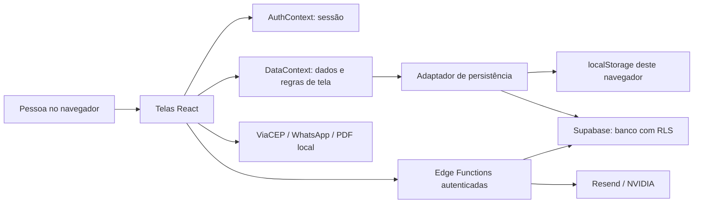

# Arquitetura e mapa do sistema

**Revisão:** 22/10/2026
**Base:** código presente neste repositório. As migrações e a publicação da atualização ainda precisam ser feitas no ambiente online; veja [ROADMAP.md](ROADMAP.md).

## 1. Resumo em linguagem simples

O sistema é um site feito com React e TypeScript. Ele roda no navegador. O navegador guarda os dados localmente ou conversa diretamente com o Supabase. Não existe um servidor próprio tradicional entre a tela e o banco. Algumas tarefas que precisam de segredos ou integração externa passam por funções pequenas hospedadas no Supabase.

## 2. Tecnologias e estrutura

| Parte | Onde fica | Responsabilidade |
|---|---|---|
| Aplicação | `src/` | React, TypeScript, Vite e Tailwind CSS. |
| Rotas | `src/App.tsx` | `HashRouter`; URLs internas aparecem após `/#/`, por exemplo `/#/clientes`. |
| Navegação | `src/components/Layout.tsx` | Menu das páginas, sessão e estado de carregamento. |
| Autenticação | `src/context/AuthContext.tsx` | Login, sessão, papel ativo (`owner`/`member`), redefinição de senha e saída. Papel inválido ou associação não ativa não recebe permissão de proprietário. |
| Estado e regras de dados | `src/context/DataContext.tsx` | Carrega e atualiza clientes, catálogo, documentos, pagamentos, produção e empresa. |
| Persistência | `src/data/adapter.ts` | Converte o modelo TypeScript para `localStorage` ou tabelas Supabase. |
| Tipos e dinheiro | `src/types.ts`, `src/lib/money.ts`, `src/lib/documento.ts` | Formatos dos registros e cálculos em centavos inteiros. |
| PDF | `src/pdf/documentoPdf.ts` | Orçamentos, faturas e guias para impressão; geração no navegador. |
| Banco | `supabase/schema.sql`, `supabase/migrations/` | Tabelas, funções e políticas RLS. |
| Funções de servidor | `supabase/functions/` | Gerenciamento de equipe, envio de e-mail e assistente de IA. |

O ponto de entrada visual é `src/main.tsx`; `src/App.tsx` organiza os provedores e as rotas. O app carrega as coleções de dados para o estado do navegador quando inicia. No Supabase, as consultas passam pelas políticas RLS usando a sessão da pessoa.

## 3. Módulos que existem

| Módulo | O que faz hoje | Principais registros |
|---|---|---|
| Dashboard | `owner` vê indicadores, gráfico financeiro, vencimentos e funil. `member` vê contagem/funil e acompanhamento operacional, sem valores financeiros consolidados. | Orçamentos, pagamentos, vendas rápidas, faturas e contas a pagar (esta última com RLS owner-only). |
| Clientes | Cadastro, busca, edição e exclusão de clientes; guarda contato, documento, endereço e observações. A ação **Histórico** mostra orçamentos e vendas rápidas associados ao cliente, para `owner` e `member`. | `clientes`, `orcamentos`, `vendas_rapidas` |
| Produtos | Catálogo de produtos/serviços com preço por unidade, preço por m², descrição e estrela para favoritos compartilhados do PDV. | `itens` |
| Orçamentos | Cria, edita, pesquisa, filtra, duplica, imprime/exporta em PDF, envia por e-mail/WhatsApp e converte em fatura. | `orcamentos` |
| Faturas | Cria faturas diretamente ou a partir de orçamento; mostra status, PDF, guia, PIX, cobrança WhatsApp, e-mail e pagamentos. | `faturas`, `pagamentos` |
| PDV | Venda de balcão sem orçamento/fatura; aceita item do catálogo ou item avulso, cliente opcional, forma de pagamento e observação. Sem busca, mostra favoritos da gráfica; se não houver favoritos, mostra todos. Com busca, pesquisa todos os itens. `member` pode inserir vendas, não vê indicadores e consulta as oito vendas rápidas mais recentes com número, data, cliente/balcão, pagamento e total, inclusive sem cliente. A lista é somente leitura; o carrinho mantém o total para fechar a venda. | `vendas_rapidas`, `itens` |
| Produção | Quadro Kanban com Arte → Impressão → Acabamento → Pronto → Entregue; cards manuais ou ligados a faturas. | `producao_cards` |
| Contas a Receber | Rota disponível apenas para `owner`; lista faturas abertas, vencidas e próximas, registra/remove pagamentos e oferece cobrança. `member` registra pagamento dentro da tela Faturas. | `faturas`, `pagamentos` |
| Contas a Pagar | Cadastra e quita despesas; rota e linhas do banco disponíveis apenas para `owner` (RLS). | `contas_pagar` |
| Relatórios | Abas de Vendas, Fluxo de Caixa e Clientes, com período e exportação CSV; acesso de `owner`. | Faturas, pagamentos, vendas rápidas, despesas e clientes. |
| Perfil da Empresa | Dados que aparecem nos documentos, logo, chave PIX, prefixo e próximos números. Consulta CEP pelo serviço ViaCEP. | `empresa` |
| Equipe | No modo Supabase, proprietário cadastra, revoga e reativa colaboradores. | `workspace_members`, usuários do Supabase Auth |
| Configurações | Exporta JSON, importa backup atual ou formato legado e informa o modo de armazenamento. No Supabase, a exportação contém os registros que a sessão pode consultar segundo a RLS. | Coleções do espaço permitidas à sessão |
| Assistente | Opcional no modo Supabase: consulta dados e propõe criar cliente, orçamento ou venda; ações exigem confirmação. Para `member`, não habilita resumo financeiro nem listagem do histórico de vendas rápidas; conserva consultas operacionais e de faturas. | Consultas RLS; NVIDIA; ações via Edge Function |

## 4. Regras atuais dos principais fluxos

### Orçamento e fatura

1. Um orçamento precisa de cliente e pelo menos um item descrito.
2. Itens podem ser calculados por unidade ou área; preços e totais são salvos em centavos inteiros.
3. O total usa: `soma dos itens + impostos por item + frete - desconto`.
4. É possível criar uma fatura sem orçamento. Ao converter um orçamento, o orçamento passa para `faturado`, a fatura começa `pendente` e um card de produção é criado na etapa `Arte`.
5. O pagamento fica em registro separado. A soma paga define `pendente`, `parcial` ou `paga`; atraso é calculado pela data de vencimento.
6. Uma fatura cancelada não recebe novo card de produção. O quadro também recupera cards ausentes para faturas existentes quando abre.

### PDV e produção

- O PDV usa preço unitário se ele existir; caso contrário, usa preço por m². Produto sem preço não pode ser acrescentado pelo catálogo. Item avulso exige descrição e valor. Na abertura aparecem os favoritos compartilhados; busca em texto pesquisa o catálogo completo.
- Uma venda do PDV é registrada em `vendas_rapidas`; por definição, não cria fatura nem card de produção.
- O cartão de produção guarda cliente, título, etapa, prazo, data de entrega, observação e ordem na coluna.
- O fluxo de produção não é controle de estoque nem emissão fiscal.

### Estados usados

| Registro | Estados disponíveis no modelo | Observação |
|---|---|---|
| Orçamento | `pendente`, `aprovado`, `faturado`, `recusado` | O tipo aceita `aprovado`; a lista de filtros visível atualmente não inclui esse filtro. |
| Fatura | `pendente`, `parcial`, `paga`, `cancelada` | Atrasada é um estado calculado a partir do vencimento, não um valor persistido. |
| Conta a pagar | `pendente`, `paga` | O dia de pagamento é salvo quando marcada como paga pela tela. |
| Produção | `arte`, `impressao`, `acabamento`, `pronto`, `entregue` | O movimento pode ocorrer por arrastar ou pelos botões da tela. |
| Acesso da equipe | `active`, `invited`, `revoked` | São valores da tabela Supabase `workspace_members`. |

## 5. Modelo de dados

| Coleção / tabela | Conteúdo | Ligações importantes |
|---|---|---|
| `clientes` | Cadastro e contatos. | Orçamentos, faturas, vendas rápidas e produção guardam `clienteId`/`cliente_id`. |
| `itens` | Produto/serviço, preços atuais e booleano `favorito` compartilhado. | Orçamento, fatura e venda guardam uma cópia descritiva dos itens para preservar o histórico. |
| `orcamentos` | Número, cliente, datas, itens, totais, termos e status. | Pode originar uma fatura; a referência é guardada na fatura. |
| `faturas` | Documento de cobrança e status. | Tem pagamentos separados e pode originar card de produção. |
| `pagamentos` | Data, valor, forma e observação recebidos. | Cada registro aponta para uma fatura. |
| `vendas_rapidas` | Venda direta do balcão com itens e total. | Cliente opcional; não depende de fatura. Todas as vendas aparecem na lista recente do PDV para `owner` e `member`; as que têm cliente também aparecem no histórico individual desse cliente. |
| `contas_pagar` | Despesa e sua quitação. | Não existe tabela de parcelas de pagamento nesta versão. |
| `producao_cards` | Trabalho e etapa do processo. | Pode referenciar fatura e cliente. |
| `empresa` | Perfil, PIX, logo e numeração. | Uma linha por espaço de gráfica no Supabase; objeto único no navegador local. |
| `workspace_members` | Pessoa, papel e status dentro da gráfica. | `owner` é administrador; `member` é colaborador. |

Os vínculos entre documentos são mantidos pela aplicação; várias colunas de ID não têm `FOREIGN KEY` no esquema atual. Não presuma exclusão em cascata de clientes e documentos. A tela de cliente informa que excluir o cliente não apaga orçamentos nem faturas.

## 6. Onde os dados ficam

| Modo | Como funciona | Limites importantes |
|---|---|---|
| Local | Um objeto JSON na chave `graficaLivre` do `localStorage` do navegador. | Não tem login, sincronização, cópia automática da aplicação nem permissão individual. Limpar dados do navegador pode apagar o sistema. |
| Nuvem | Banco Supabase, acessado pelo cliente autenticado e protegido por RLS. | `owner` vê os indicadores e módulos financeiros. `member` não abre Contas a Receber, Contas a Pagar ou Relatórios; RLS restringe `contas_pagar` a `owner`, permite inserir venda e consultar vendas rápidas do próprio espaço. Faturas, pagamentos e itens continuam compartilhados para operação e favoritos. |

O adaptador traduz `camelCase` do TypeScript para `snake_case` do banco. Favoritos usam `itens.favorito`, são compartilhados entre membros e itens/backups antigos sem o campo são lidos como não favoritos.

## 7. Autenticação e papéis atuais

- Com `VITE_SUPABASE_URL` e `VITE_SUPABASE_ANON_KEY`, o app entra no modo nuvem e pede login. Sem essas variáveis, entra no modo local.
- O primeiro login pode criar o espaço de proprietário por `ensure_workspace_membership()`; as credenciais de colaboradores são criadas pelo servidor na função `gerenciar-colaboradores`.
- A criação, revogação e reativação de usuários é validada no backend como operação de `owner`.
- `current_workspace_role()` devolve o papel ativo da sessão; `current_workspace_owner_id()` deixa de aceitar associações `invited` ou `revoked`.
- RLS restringe `contas_pagar` a `owner`. `vendas_rapidas` pode ser inserida por membro e, conforme PDV-02, lida integralmente por membro no mesmo espaço, mas não atualizada ou excluída. A lista do PDV mostra as oito mais recentes; o histórico de cliente é uma junção visual das coleções `orcamentos` e `vendas_rapidas`, filtradas por `clienteId`, na tela Clientes. Tabelas `faturas`/`pagamentos` continuam compartilhadas: sustentam a tela Faturas permitida aos membros. Contas a Receber é bloqueada na interface/rota, mas não tem tabela isolada própria.
- A equipe ainda não pode ser controlada no modo local.
- O cadastro público do Supabase deve permanecer desligado na instalação orientada pelo [DEPLOY](DEPLOY.md).

## 8. Integrações e segredos

| Integração | Uso | Condição |
|---|---|---|
| Supabase Auth e Database | Login, sessão, banco e RLS. | Necessário para várias pessoas/dispositivos. |
| Edge Function `gerenciar-colaboradores` | Cria/revoga/reativa contas de equipe. Usa chave privilegiada no servidor. | Necessária para a tela Equipe funcionar completamente. |
| Resend / `enviar-email` | Envia orçamento ou fatura em PDF por e-mail. | Opcional; requer `RESEND_API_KEY` e remetente configurado/verificado. |
| NVIDIA / `assistente-ia` | Responde perguntas e consulta dados por ferramentas. | Opcional; requer `NVIDIA_API_KEY`. Mensagens e resultados consultados são enviados ao serviço externo. |
| ViaCEP | Consulta endereço a partir do CEP. | Opcional e acionado no formulário de empresa. |
| WhatsApp | Abre conversa/cobrança com texto preenchido. | A pessoa ainda confirma o envio no WhatsApp. |
| PDF e PIX | Gera PDF/QR Code no navegador a partir dos dados da gráfica. | Não substitui documento fiscal nem confirma pagamento bancário. |

Guarde segredos no cofre e no ambiente do provedor. O mapa de nomes e responsáveis fica em [ACESSOS.md](ACESSOS.md); nunca registre valores reais ali.

## 9. Limites conhecidos

- Não é ERP fiscal e não emite NF-e, NFC-e, SAT ou escrituração.
- Não há estoque, compras automatizadas, conciliação bancária ou controle de caixa por operador.
- Não há suíte automatizada de testes configurada.
- O modo local não separa permissões por papel; favoritos são compartilhados no armazenamento daquele navegador.
- A aplicação das migrações pendentes, incluindo `20261022120000_historico_pedidos_cliente.sql` e `20261022130000_vendas_rapidas_member_history.sql`, no banco online e a publicação do frontend ainda estão pendentes.
- O estado atual do sistema e os achados de segurança/qualidade estão em [AUDITORIA.md](AUDITORIA.md).
