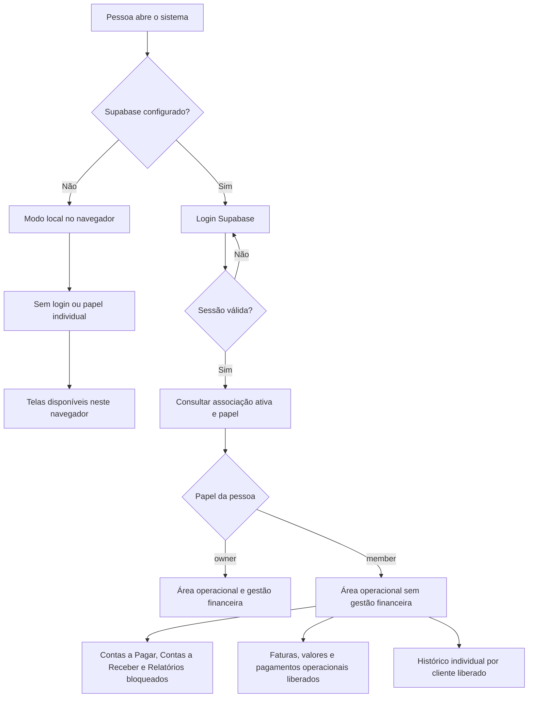
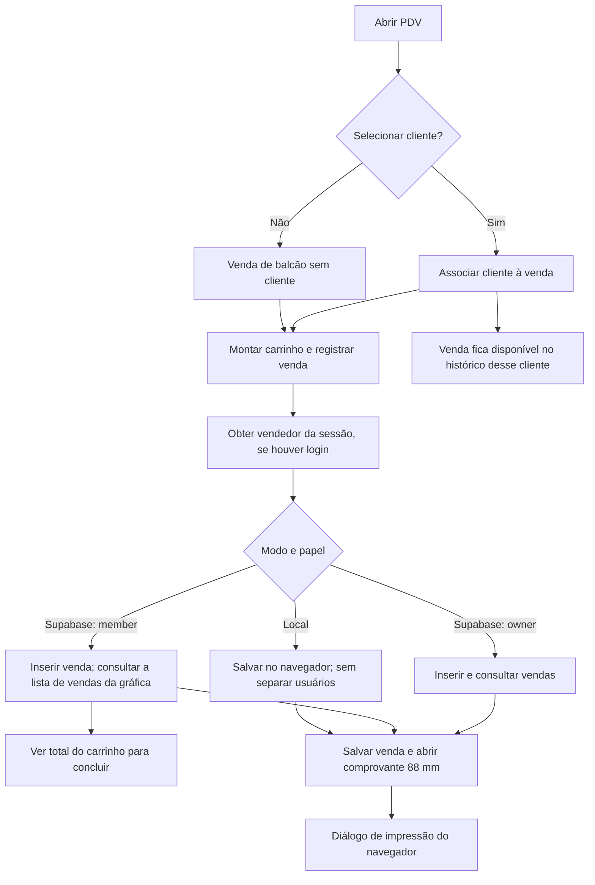
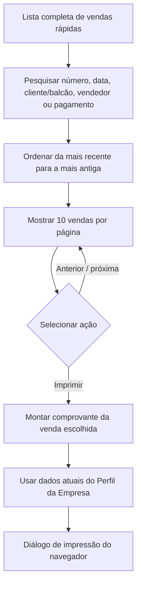
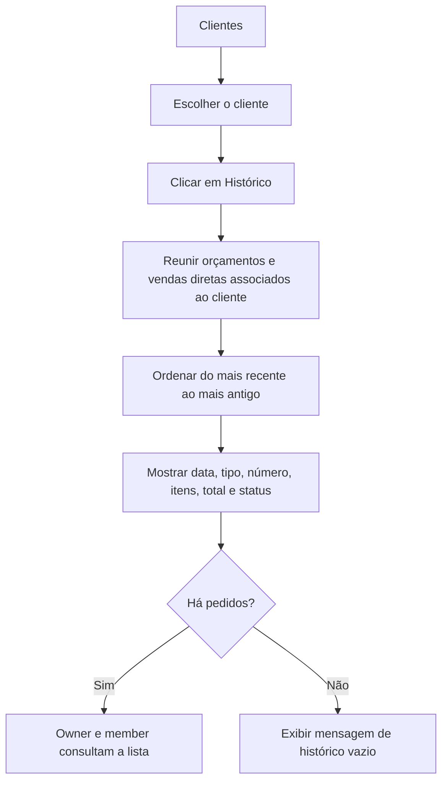
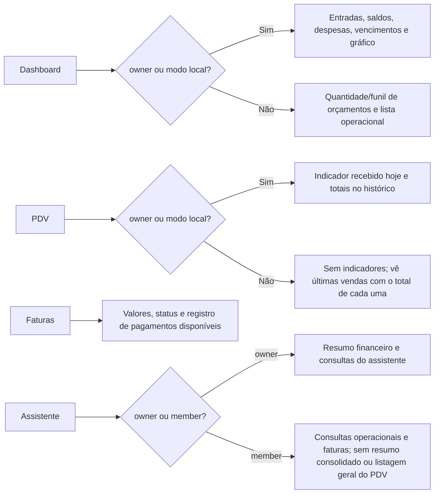
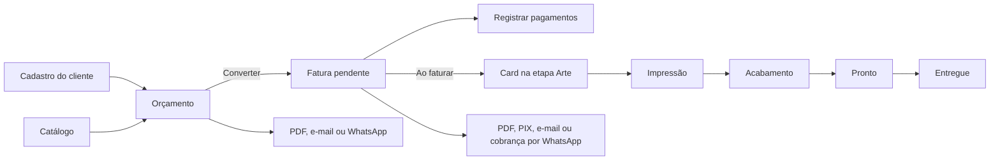
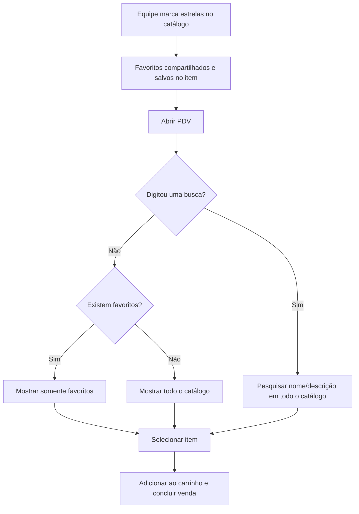

# Fluxo do Gráfica Livre

**Revisão:** 22/10/2026
**Estado:** FIN-01, PDV-01, HIST-01, PDV-02, PDV-03, PDV-04, PDV-05 e EMP-01 implementados no código. Lint, build e conferência manual do PDV concluídos localmente; o modo local não simula `member` nem autoria autenticada. Aplicar migração, validar RLS/autoria online e publicar ainda estão pendentes.
**Regras detalhadas:** [PRD.md](PRD.md). Este desenho explica o caminho, não substitui os critérios de aceite.

## 1. Abrir o sistema e decidir o acesso

O menu e a rota bloqueiam as telas financeiras para `member`. RLS libera `contas_pagar` somente a `owner`; em `vendas_rapidas`, o colaborador pode inserir uma venda e consultar o histórico completo do próprio espaço. Faturas e pagamentos permanecem compartilhados porque são usados no atendimento e na cobrança.

### 1.1 O que acontece com uma venda rápida

No Supabase, a RLS permite ao colaborador consultar as vendas rápidas do próprio espaço, inclusive as vendas sem cliente; não permite alteração ou exclusão. A inserção exige que o ID do vendedor corresponda à sessão autenticada. No modo local, o navegador não identifica quem está usando o sistema, então a venda fica “Não identificado”. Cancelar a janela de impressão não desfaz o registro.

### 1.2 Buscar e reimprimir uma venda

### 1.3 Consultar pedidos de um cliente

## 2. O que cada papel enxerga no resumo

Orçamentos e faturas continuam mostrando os valores necessários para preparar documentos. O total do carrinho também continua visível para a pessoa concluir uma venda.

## 3. Orçamento, fatura e produção

Um orçamento exige cliente e item descrito. O valor é calculado em centavos. A conversão cria uma fatura e um card de produção; pagamentos ficam ligados à fatura e definem seu status.

## 4. Favoritos e busca no PDV

Marcar um item como favorito não altera preço nem histórico. Se a equipe ainda não marcou nenhum, o PDV continua mostrando todos os itens; quando a pessoa pesquisa, a busca sempre inclui também os não favoritos.

## 5. Passos simples para a equipe

1. O proprietário cadastra produtos e marca com estrela os que saem com frequência.
2. Para achar um desses produtos, a equipe abre o PDV e seleciona um dos favoritos.
3. Para qualquer outro produto, basta pesquisar pelo nome ou pela descrição.
4. O valor e a quantidade da venda continuam no carrinho para finalizar o atendimento.
5. Para um serviço que exige proposta, crie um orçamento, depois converta em fatura e acompanhe o card na Produção.
6. Registre recebimentos na própria fatura. O colaborador não usa Contas a Receber; essa tela e Contas a Pagar ficam para o proprietário.
7. No PDV, proprietário e colaborador pesquisam a lista completa de vendas rápidas e consultam 10 registros por página, incluindo os de balcão; cada registro mostra vendedor e tem botão **Imprimir**.
8. Ao concluir uma venda, o comprovante não fiscal de 88 mm abre para impressão. A pessoa escolhe a impressora no navegador; cancelar a impressão mantém a venda salva.
9. Preencha a Inscrição Estadual em **Perfil da Empresa** para que ela apareça no comprovante.
10. Na lista de Clientes, clique em **Histórico** para consultar orçamentos e vendas associados ao cliente. Ao registrar uma venda no PDV, selecione o cliente para que ela apareça nesse histórico individual.
11. O Dashboard de colaborador mostra o acompanhamento operacional sem entradas, despesas ou saldos financeiros consolidados.

## 6. Limites do modo local e da publicação

- O modo local não sabe quem é proprietário ou colaborador; quem usa o mesmo perfil do navegador vê os mesmos dados.
- No modo Supabase, os papéis `owner` e `member` são carregados da associação ativa da gráfica.
- O bloqueio do acesso de `member` a `contas_pagar`, favoritos compartilhados e permissão de leitura das vendas rápidas dependem das migrações SQL descritas em [DEPLOY.md](DEPLOY.md) no banco online.
- Este fluxograma descreve a versão em código. Não significa que o ambiente de produção já recebeu a migração ou o frontend.
