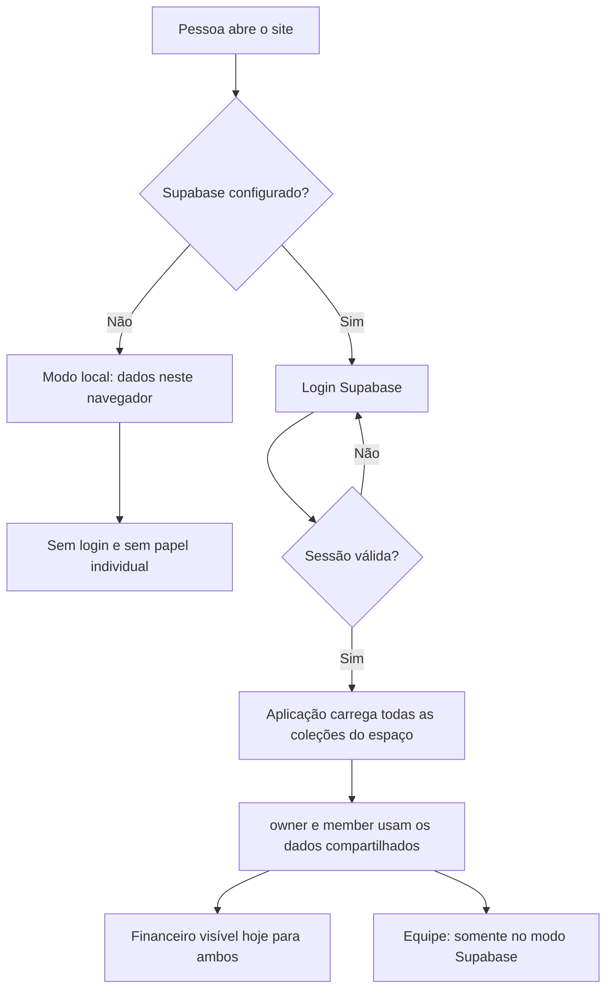
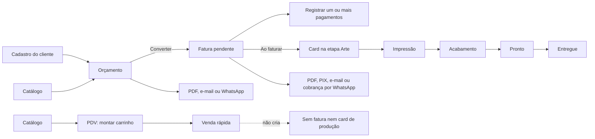
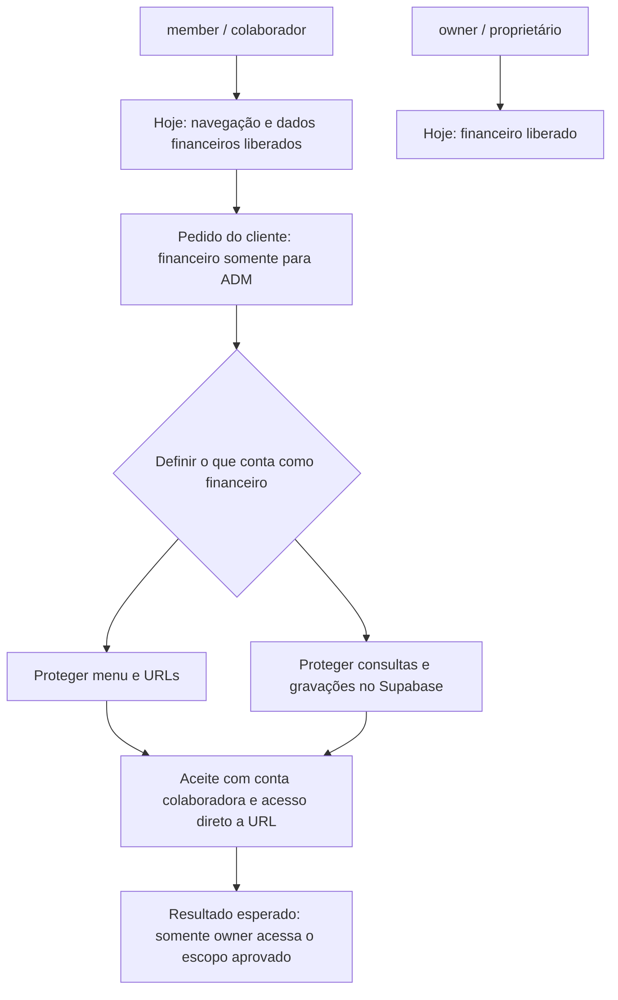
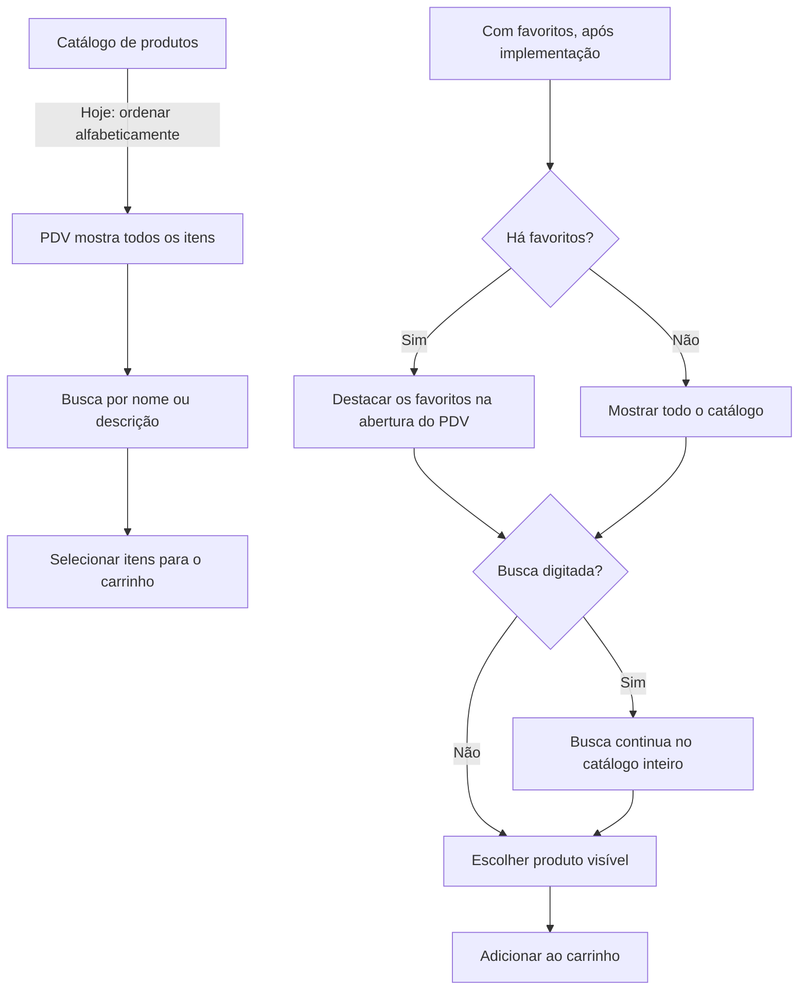

# Fluxograma do sistema

Este documento separa o comportamento que o código tem hoje do comportamento solicitado para a próxima atualização. A auditoria está em [AUDITORIA.md](AUDITORIA.md); os requisitos estão em [PRD.md](PRD.md).

## 1. Abertura e acesso — comportamento atual

### Acesso atual em duas frases

- No modo local, quem usa esse navegador acessa os dados salvos nele; não existe separação entre funcionários.
- No modo Supabase, RLS separa uma gráfica da outra. Dentro da mesma gráfica, `owner` e `member` compartilham os registros, inclusive os financeiros. A função de equipe exige proprietário para cadastrar/revogar/reativar contas.

## 2. Fluxo comercial e de produção — comportamento atual

O total do orçamento/fatura é calculado em centavos: soma dos itens + impostos por item + frete − desconto. No PDV, o preço unitário é usado quando está preenchido; senão, é usado o preço por m². A venda rápida permite item avulso.

## 3. Pedido financeiro — estado atual e destino

**Ainda não é o comportamento publicado.** O cliente pediu restrição da área financeira. A lista mínima proposta está em FIN-01 no PRD; falta confirmar o alcance sobre valores de faturas, pagamentos, Dashboard e PDV. Um menu escondido sem bloqueio de rota e RLS não completa a regra.

## 4. Pedido de favoritos — comportamento atual e destino

**Ainda não implementado:** hoje não há campo de favorito. A forma de persistir e se os favoritos serão compartilhados ou individuais precisam ser confirmadas. A gravação da venda e a busca por nome/descrição já existem.

## 5. Como explicar para a equipe

1. Cadastre cliente e produtos.
2. Para um serviço que exige proposta, crie orçamento e envie o PDF.
3. Quando aprovado, converta em fatura; a produção começa automaticamente em Arte.
4. Registre pagamentos na fatura e mova o card conforme o trabalho avança.
5. Para venda simples de balcão, use o PDV; essa venda fica separada de faturas e produção.
6. Hoje, colaborador também consegue ver o financeiro. A equipe deve saber que a restrição pedida ainda não foi implantada.
